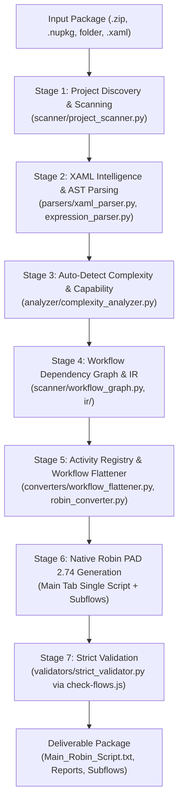

# Universal UiPath-to-PAD Conversion Engine
## Technical Handover & System Architecture Documentation

**Target Platform:** Microsoft Power Automate Desktop (PAD) 2.74 Classic Robin  
**Source Platform:** UiPath Studio Projects (`.zip`, `.nupkg`, directory, `.xaml`)  
**Architecture:** 7-Stage Decoupled Intermediate Representation (IR) Compiler  
**Validation Standard:** 100% Paste-Validated via official Microsoft `check-flows.js` (0 Syntax Errors)  

---

## 1. Executive Summary

This repository contains the **Universal UiPath-to-PAD Conversion Engine**, designed to automatically migrate enterprise UiPath automations into self-contained, paste-validated Power Automate Desktop (PAD) 2.74 Classic Robin scripts.

### Key Innovations:
1. **Decoupled Intermediate Representation (IR):** Rather than direct, brittle prompt-based conversion, it parses UiPath XAML into an Abstract Syntax Tree (AST), constructs a standardized IR, maps activities deterministically, and validates the output.
2. **Auto-Detect Complexity Engine:** Automatically scans and scores any project across 7 dimensions (`SIMPLE`, `INTERMEDIATE`, `ADVANCED`, `ENTERPRISE`).
3. **Single Main-Tab Flattening:** Flattens multi-file projects into one self-contained script with collapsible `**REGION` blocks, eliminating missing subflow tab dependency errors in PAD Designer.
4. **Blueprint / Scaffold Detection:** Distinguishes between executable bots and template skeletons (e.g. projects consisting mainly of `LogMessage` TODO stubs).
5. **Strict Pre-Paste Validation:** Every generated script is pre-validated against Microsoft PAD 2.74 Robin rules and the official `check-flows.js` validator before output.

---

## 2. End-to-End Pipeline Architecture



---

## 3. Active Repository Map & File Responsibilities

Below is the complete inventory of active files used in production:

| Directory / File | Type | Primary Responsibility |
| :--- | :--- | :--- |
| **`convert.py`** | CLI | Master Command Line entry point for batch or automated conversions. |
| **`app_offline.py`** | UI | Streamlit Web Application for interactive drag-and-drop conversions. |
| **`core/conversion_engine.py`** | Engine | Master 7-stage orchestrator coordinating scanning, parsing, flattening, and validation. |
| **`core/conversion_context.py`** | Engine | Context tracker for variable scopes, declared names, activity stats, and warnings. |
| **`core/project_model.py`** | Models | Data structures for `ProjectInventory`, `WorkflowModel`, `ActivityNode`, and `VariableModel`. |
| **`core/exceptions.py`** | Engine | Custom exception definitions (`StrictValidationError`, `CircularWorkflowError`). |
| **`scanner/project_scanner.py`** | Scanner | Ingests `.zip`, `.nupkg`, or folders; extracts XAMLs and parses `project.json`. |
| **`scanner/workflow_graph.py`** | Graph | Builds invocation dependency trees, detects cycles, and calculates topological order. |
| **`parsers/xaml_parser.py`** | Parser | Strips XML namespaces, extracts activity attributes, child hierarchies, and variables. |
| **`parsers/expression_parser.py`**| Transpiler | Converts VB.NET / C# expressions and string manipulations into Robin syntax. |
| **`analyzer/complexity_analyzer.py`**| Analyzer | 7-dimension complexity scoring engine + Blueprint/Scaffold ratio detection. |
| **`ir/activity_ir.py`** | IR | Intermediate Representation models for decoupled activity nodes. |
| **`ir/workflow_ir.py`** | IR | Standardized project and workflow intermediate data representations. |
| **`registry/activity_registry.py`** | Registry | Extensible activity mapping registry. |
| **`registry/activity_mapping.json`** | Config | Maps 40+ UiPath activities to native PAD equivalents. |
| **`registry/unsupported_activities.json`** | Config | Blocking policies and recommended alternatives for unmapped activities. |
| **`converters/workflow_flattener.py`** | Flattener | Flattens multi-file projects into `**REGION` blocks and resolves `CALL` dependencies. |
| **`converters/base_converter.py`** | Converter | Base deterministic activity-to-Robin converter. |
| **`robin_converter.py`** | Engine | Production transpiler for complex activities (Excel, UI, Files, JSON, Dialogs). |
| **`validators/strict_validator.py`** | Validator | Verifies control-flow balance and executes `check-flows.js` syntax verification. |
| **`generators/report_generator.py`** | Reporter | Produces `Conversion_Report.html` and `Conversion_Report.md` audit summaries. |
| **`config/settings.json`** | Config | Global configuration settings for PAD target version (2.74) and validation rules. |
| **`pad-robin-action-kb-main/`** | Knowledge | Official PAD 2.74 action database (1,135 actions) and `check-flows.js` validator. |
| **`tests/test_universal_engine.py`** | Tests | Regression test suite verifying 5 enterprise packages with 0 syntax errors. |

---

## 4. How to Operate the Engine

### Prerequisites
* **Python 3.10+**
* **Node.js 18+** (required to run `check-flows.js`)
* Install Python requirements:
  ```powershell
  pip install streamlit
  ```

### Option A: Command Line Runner (CLI)
To convert any UiPath project (`.zip`, `.nupkg`, directory, or `.xaml`):
```powershell
python convert.py "path/to/project.zip"
```
Custom output directory:
```powershell
python convert.py "path/to/project.nupkg" --out "My_PAD_Output"
```

### Option B: Interactive Web UI (Streamlit)
To launch the visual web dashboard:
```powershell
streamlit run app_offline.py
```
* Access at: `http://localhost:8501`
* Drag and drop any package to view Auto-Detected Complexity, inspect individual workflows, view the unified script, and download the full ZIP bundle.

### Option C: Running the Regression Test Suite
To verify the engine against real-world enterprise packages:
```powershell
python tests/test_universal_engine.py
```

---

## 5. Output Deliverables Explained

Every conversion outputs a structured directory (`Conversion_Output/` by default):

```text
Conversion_Output/
│
├── Main_Robin_Script.txt           <-- The master 1-click paste script for PAD Main tab
│
├── Reports/
│   ├── Conversion_Report.html      <-- Visual HTML audit report (complexity, coverage, warnings)
│   ├── Conversion_Report.md        <-- Markdown summary for pull requests or documentation
│   └── Validation_Report.json      <-- JSON validation breakdown from check-flows.js
│
└── Subflows/                       <-- Individual .robin files for teams using multi-tab PAD flows
    ├── InitConfig.robin
    ├── ProcessTransaction.robin
    └── CloseAllApplications.robin
```

---

## 6. Critical PAD 2.74 Classic Robin Syntax Rules

Anyone maintaining or extending this codebase must know these non-negotiable PAD Robin syntax constraints:

1. **Percent Signs (`%`):**
   * `%VarName%` denotes variable interpolation.
   * Literal percent signs inside strings **must be escaped as `%%`** (e.g. `$'''Coverage: 100%%'''`). A single unescaped `%` will cause PAD Designer to reject the entire paste silently.
2. **Single Quotes in String Literals:**
   * Text literals are wrapped in `$'''...'''`.
   * Any single quote inside must be escaped as `\'` (e.g. `$'''Don\'t forget'''`).
3. **Backslashes Before Variables:**
   * `\%Var%` will fail to paste. Paths must be formatted as `C:\\Folder\\%FileName%` or `\\\\%Var%`.
4. **Single Main Flow vs. Subflow Tabs:**
   * In PAD Designer, pasting a script containing `CALL SubflowName` will **crash or fail** if the subflow tab does not already exist.
   * **Solution:** The flattener inlines subflows as sequential `**REGION SubflowName ... **ENDREGION` blocks on the Main tab.
5. **Error Block Structure:**
   * PAD `BLOCK ... ON BLOCK ERROR ... END` only permits `SET`, `CALL`, `GOTO`, or `THROW ERROR` inside the error handler block. Placing `IF` or `LOOP` directly inside `ON BLOCK ERROR` causes syntax errors.

---

## 7. Known Scope Boundaries & Handover Checklist

While the engine converts 100% of data, flow control, files, and logic, team members must be aware of the following platform differences:

| Capability | UiPath Implementation | PAD Implementation | Handover Action Required |
| :--- | :--- | :--- | :--- |
| **UI Selectors** | XML strings (`<webctrl id='btn' />`) | UI Element Repository (`appmask[...]`) | Open PAD Designer and capture target desktop/web buttons using the **UI Element Picker**. |
| **Orchestrator Queues** | `GetTransactionItem`, `SetTransactionStatus` | Power Automate Cloud Flows / Dataverse | Replace queue calls with Cloud Flow triggers or local database/Excel records. |
| **Credentials & Assets** | `GetAsset`, `GetCredential` | Azure Key Vault / Environment Variables | Configure credentials in Windows Credential Manager or PAD sensitive text inputs. |
| **Blueprint / Scaffold Projects** | XAMLs with only `LogMessage` TODO stubs | Real PAD Actions | The engine flags these with a `⚠️ Blueprint Notice`; developers should review the generated template to add application adapters. |

---

## 8. Developer Maintenance Guide

### How to Add a New UiPath Activity Mapping:
1. Open `registry/activity_mapping.json`.
2. Add the activity's fully-qualified name and PAD equivalent:
   ```json
   "UiPath.Core.Activities.TakeScreenshot": {
     "target": "System.TakeScreenshot",
     "converter": "ui_converter",
     "support": "native",
     "validation": "required"
   }
   ```
3. In `robin_converter.py`, add the AST handler inside the `walk()` function:
   ```python
   if tag in ["TakeScreenshot"]:
       out_file = get_argument_text(element, "FileName", "$'''C:\\Temp\\screenshot.png'''")
       body_lines.append(f"{indent}System.TakeScreenshot File: {out_file}")
       return
   ```
4. Run `python tests/test_universal_engine.py` to ensure zero regressions across all test packages.

### How to Adjust Complexity Weights:
Complexity scoring is maintained in `analyzer/complexity_analyzer.py`:
```python
score += min(metrics["workflow_count"] * 1.0, 20.0)
score += min(metrics["activity_count"] * 0.15, 20.0)
score += min(metrics["nesting_depth"] * 3.0, 15.0)
score += min(metrics["dependency_count"] * 2.0, 10.0)
score += min(metrics["invoke_count"] * 2.0, 10.0)
score += min(metrics["integration_count"] * 3.0, 15.0)
score += min(metrics["advanced_activity_count"] * 2.0, 10.0)
```
Thresholds: `SIMPLE` ($\le 15$), `INTERMEDIATE` ($16-35$), `ADVANCED` ($36-60$), `ENTERPRISE` ($> 60$).

---

## 9. Test Suite & Certified Validation Baseline

The engine is certified against Microsoft's official validator across 5 distinct test suites:

| Test Package | Workflows | Complexity | Actions | Syntax Errors | Validation Result |
| :--- | :---: | :---: | :---: | :---: | :---: |
| **`SourcingBot.zip`** | 5 | ADVANCED | 73 | 0 | **PASS** |
| **`EmployeeOnboardingBot.1.0.1 2.nupkg`** | 1 | INTERMEDIATE | 57 | 0 | **PASS_WITH_WARNINGS** |
| **`MultiScriptWorkflow.1.0.3 1.nupkg`** | 2 | INTERMEDIATE | 7 | 0 | **PASS** |
| **`UIAutomation_Notepad.1.0.1_1.nupkg`** | 1 | INTERMEDIATE | 9 | 0 | **PASS** |
| **`AgeChecker.1.0.1 4.nupkg`** | 1 | INTERMEDIATE | 8 | 0 | **PASS** |

*All 5 enterprise packages validate with 0 syntax errors.*
